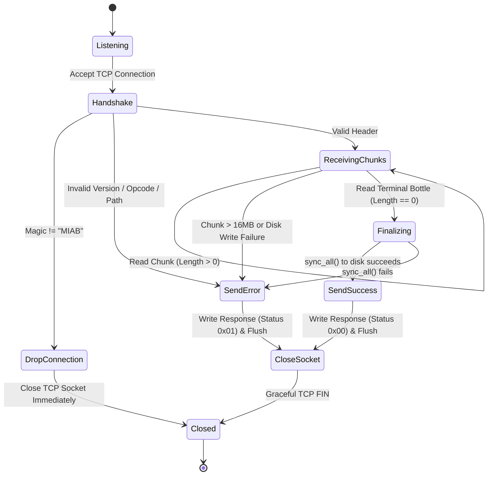
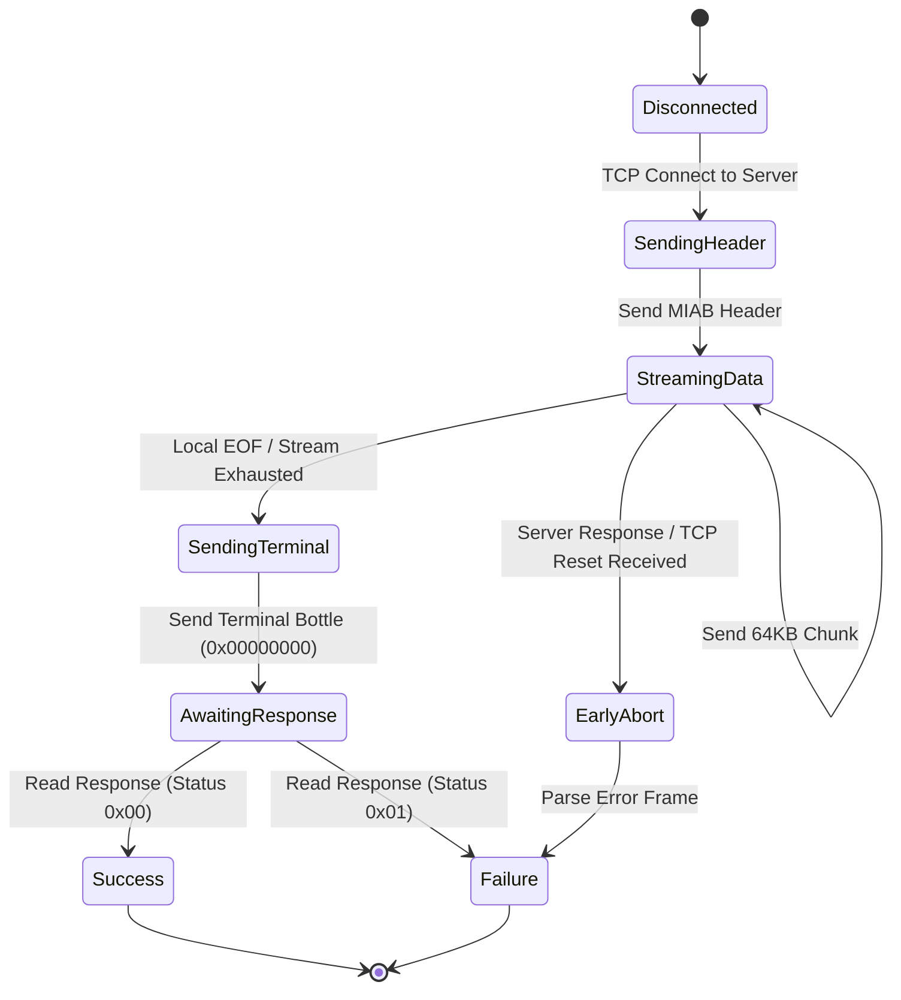

# RFC 001: Message In A Bottle Wire Protocol (MIAB v1)

```
Network Working Group                                          MIAB Project
Request for Comments: 001                                   Protocol Engine
Category: Standards Track                                      October 2026
```

---

## Abstract

This document defines the Message In A Bottle (MIAB) Transport Protocol version 1 (MIAB v1). MIAB is a lightweight, high-performance, bounded-memory binary blob transport engine designed specifically for edge nodes, IoT devices, embedded systems, and homelabs operating over private networks (e.g., Tailscale, WireGuard, LAN).

MIAB eliminates the protocol and memory overhead of HTTP/REST, multipart MIME, and gRPC, operating over a single raw TCP connection using strict big-endian binary framing and chunked streams ("Bottles").

---

## Status of This Document

This document is the official wire protocol specification for MIAB v1. Conforming implementations in any programming language MUST adhere to the wire representations, state transitions, and security constraints described herein.

---

## Table of Contents

1. [Terminology & Conformance](#1-terminology--conformance)
2. [Protocol Architecture](#2-protocol-architecture)
3. [Data Types & Endianness](#3-data-types--endianness)
4. [Wire Framing Specification](#4-wire-framing-specification)
   - 4.1. [Initial Header (Client $\rightarrow$ Server)](#41-initial-header-client--server)
   - 4.2. [Bottle Chunks (Client $\rightarrow$ Server)](#42-bottle-chunks-client--server)
   - 4.3. [Terminal Bottle / EOF (Client $\rightarrow$ Server)](#43-terminal-bottle--eof-client--server)
   - 4.4. [Server Response (Server $\rightarrow$ Client)](#44-server-response-server--client)
5. [State Machine & Connection Lifecycle](#5-state-machine--connection-lifecycle)
6. [Security Considerations & Path Sanitization](#6-security-considerations--path-sanitization)
7. [Error Handling & Failure Modes](#7-error-handling--failure-modes)
8. [Implementation Guardrails](#8-implementation-guardrails)
9. [Test Vectors & Binary Examples](#9-test-vectors--binary-examples)
10. [Network Configuration](#10-network-configuration)

---

## 1. Terminology & Conformance

The key words **"MUST"**, **"MUST NOT"**, **"REQUIRED"**, **"SHALL"**, **"SHALL NOT"**, **"SHOULD"**, **"SHOULD NOT"**, **"RECOMMENDED"**, **"MAY"**, and **"OPTIONAL"** in this document are to be interpreted as described in [RFC 2119](https://www.ietf.org/rfc/rfc2119.txt).

- **Client**: The initiating network endpoint sending a binary payload or file.
- **Server / Daemon (`miabd`)**: The receiving network daemon writing payloads safely into a configured storage root.
- **Bottle**: A discrete length-prefixed chunk of binary payload data.
- **Terminal Bottle**: A zero-length bottle signaling End-Of-File (EOF).

---

## 2. Protocol Architecture

MIAB operates on a point-to-point connection over a stream-oriented transport layer (TCP). A complete transfer session executes within a single TCP connection:

```
Client                                                   Server
  |                                                         |
  |--- [1] Initial Header (Magic, Version, Opcode, Path) --->|
  |                                                         |
  |--- [2] Bottle Chunk 1 (Length L1, Payload L1) --------->|
  |--- [3] Bottle Chunk 2 (Length L2, Payload L2) --------->|
  |--- [...] Bottle Chunk N ------------------------------->|
  |                                                         |
  |--- [4] Terminal Bottle (Length = 0x00000000) ---------->|
  |                                                         |
  |<-- [5] Server Response (Status, Message Length, Msg) ---|
  |                                                         |
 [TCP Close]                                           [TCP Close]
```

1. **Client Connects**: The client initiates a TCP connection to the server (default port `6422`).
2. **Initial Header**: The client sends the handshake header containing protocol identification, version, opcode, and relative target path.
3. **Chunk Streaming**: The client streams sequential data chunks of arbitrary size (typically 64 KB).
4. **Terminal Bottle**: The client sends a 4-byte chunk header with `Length = 0` to signal payload completion.
5. **Server Acknowledgment**: The server flushes and syncs data to durable storage, transmits a response frame, and terminates the TCP connection.

---

## 3. Data Types & Endianness

All multi-byte numeric fields in the MIAB protocol **MUST** be transmitted in **network byte order (Big-Endian)**.

| Type | Size | Description |
| :--- | :--- | :--- |
| `u8` | 1 byte | Unsigned 8-bit integer (0 to 255) |
| `u16` | 2 bytes | Unsigned 16-bit integer, Big-Endian (0 to 65,535) |
| `u32` | 4 bytes | Unsigned 32-bit integer, Big-Endian (0 to 4,294,967,295) |
| `bytes` | Variable | Raw binary octet slice |
| `string` | Variable | UTF-8 encoded text string, length-prefixed, without null termination |

---

## 4. Wire Framing Specification

### 4.1. Initial Header (Client $\rightarrow$ Server)

Sent immediately by the client upon establishing the TCP connection.

```
 0                   1                   2                   3
 0 1 2 3 4 5 6 7 8 9 0 1 2 3 4 5 6 7 8 9 0 1 2 3 4 5 6 7 8 9 0 1
+-+-+-+-+-+-+-+-+-+-+-+-+-+-+-+-+-+-+-+-+-+-+-+-+-+-+-+-+-+-+-+-+
|                       Magic "MIAB" (4B)                       |
+-+-+-+-+-+-+-+-+-+-+-+-+-+-+-+-+-+-+-+-+-+-+-+-+-+-+-+-+-+-+-+-+
|  Version (1B) |  Opcode (1B)  |       Path Length N (2B)      |
+-+-+-+-+-+-+-+-+-+-+-+-+-+-+-+-+-+-+-+-+-+-+-+-+-+-+-+-+-+-+-+-+
|                     Relative Path (N Bytes)                   |
|                              ...                              |
+-+-+-+-+-+-+-+-+-+-+-+-+-+-+-+-+-+-+-+-+-+-+-+-+-+-+-+-+-+-+-+-+
```

#### Field Definitions:

1. **Magic Bytes (4 bytes)**:
   - Fixed byte sequence: ASCII `"MIAB"` (`[0x4D, 0x49, 0x41, 0x42]`).
   - If the first 4 bytes received do not match this exact sequence, the server **MUST** drop the connection immediately without transmitting any response frame.
2. **Protocol Version (1 byte)**:
   - Value for this specification: `0x01`.
   - If the server receives an unsupported version, it **MUST** reject the transfer.
3. **Command / Opcode (1 byte)**:
   - `0x01` = `PUT` / `STREAM`.
   - All other values are reserved for future protocol revisions.
4. **Path Length (2 bytes, `u16` BE)**:
   - Length $N$ in bytes of the relative path string ($1 \le N \le 65535$).
5. **Path String ($N$ bytes)**:
   - Valid UTF-8 encoded relative destination path (e.g., `"logs/node_01/sys.log"`).
   - **MUST NOT** include null-terminating characters (`\0`).

---

### 4.2. Bottle Chunks (Client $\rightarrow$ Server)

Following the Initial Header, the payload data is transmitted as a stream of zero or more sequential chunks:

```
 0                   1                   2                   3
 0 1 2 3 4 5 6 7 8 9 0 1 2 3 4 5 6 7 8 9 0 1 2 3 4 5 6 7 8 9 0 1
+-+-+-+-+-+-+-+-+-+-+-+-+-+-+-+-+-+-+-+-+-+-+-+-+-+-+-+-+-+-+-+-+
|                      Chunk Length L (4B)                      |
+-+-+-+-+-+-+-+-+-+-+-+-+-+-+-+-+-+-+-+-+-+-+-+-+-+-+-+-+-+-+-+-+
|                     Chunk Payload (L Bytes)                   |
|                              ...                              |
+-+-+-+-+-+-+-+-+-+-+-+-+-+-+-+-+-+-+-+-+-+-+-+-+-+-+-+-+-+-+-+-+
```

#### Field Definitions:

1. **Chunk Length (4 bytes, `u32` BE)**:
   - Length $L$ in bytes of the upcoming payload slice ($1 \le L \le 16777216$).
   - Standard client chunk size is **65,536 bytes (64 KB)**.
   - Servers **MUST** enforce a maximum chunk limit of **16 MB (16,777,216 bytes)** to guard against buffer exhaustion attacks.
2. **Chunk Payload ($L$ bytes)**:
   - Raw binary bytes of the chunk.

---

### 4.3. Terminal Bottle / EOF (Client $\rightarrow$ Server)

To signal completion of the payload stream, the client **MUST** transmit a Terminal Bottle:

```
 0                   1                   2                   3
 0 1 2 3 4 5 6 7 8 9 0 1 2 3 4 5 6 7 8 9 0 1 2 3 4 5 6 7 8 9 0 1
+-+-+-+-+-+-+-+-+-+-+-+-+-+-+-+-+-+-+-+-+-+-+-+-+-+-+-+-+-+-+-+-+
|                 Chunk Length = 0x00000000 (4B)                |
+-+-+-+-+-+-+-+-+-+-+-+-+-+-+-+-+-+-+-+-+-+-+-+-+-+-+-+-+-+-+-+-+
```

- Exactly 4 bytes of zeros: `[0x00, 0x00, 0x00, 0x00]`.
- No payload bytes follow the Terminal Bottle.

---

### 4.4. Server Response (Server $\rightarrow$ Client)

Upon receipt of the Terminal Bottle (or upon encountering a fatal validation/IO error), the server transmits a final response frame:

```
 0                   1                   2                   3
 0 1 2 3 4 5 6 7 8 9 0 1 2 3 4 5 6 7 8 9 0 1 2 3 4 5 6 7 8 9 0 1
+-+-+-+-+-+-+-+-+-+-+-+-+-+-+-+-+-+-+-+-+-+-+-+-+-+-+-+-+-+-+-+-+
|  Status (1B)  |       Message Length M (2B)   |               |
+-+-+-+-+-+-+-+-+-+-+-+-+-+-+-+-+-+-+-+-+-+-+-+-+               |
|                    Message String (M Bytes)                   |
|                              ...                              |
+-+-+-+-+-+-+-+-+-+-+-+-+-+-+-+-+-+-+-+-+-+-+-+-+-+-+-+-+-+-+-+-+
```

#### Field Definitions:

1. **Status Code (1 byte)**:
   - `0x00` = **Success (OK)**
   - `0x01` = **Error (FAIL)**
2. **Message Length (2 bytes, `u16` BE)**:
   - Length $M$ in bytes of the UTF-8 explanatory message.
3. **Message String ($M$ bytes)**:
   - UTF-8 text explaining the status (e.g., `"Saved 1048576 bytes"` or `"Path traversal detected: Path cannot contain '..'" `).

---

## 5. State Machine & Connection Lifecycle

### 5.1. Server Connection Lifecycle



### 5.2. Client State Machine



---

## 6. Security Considerations & Path Sanitization

Servers **MUST** enforce strict destination path validation before opening any file descriptor. Incoming paths **MUST NOT** be trusted blindly.

### 6.1. Mandatory Path Invariants

A server **MUST** reject any relative path that violates any of the following rules:

1. **Empty Path**: The path string length $N$ MUST NOT be `0`.
2. **Leading Slashes**: The path MUST NOT begin with `/` (POSIX root) or `\` (Windows root).
3. **Directory Traversal**: The path MUST NOT contain any directory component equal to `".."` or substring `".."`.
4. **Drive Prefixes & Windows Identifiers**: The path MUST NOT contain colons (`:`) or Windows drive letters (e.g., `"C:"`, `"D:\"`).
5. **Component Normalization**: All path components MUST resolve strictly to normal path segments within the configured `--storage-root`.

### 6.2. Directory Creation
The server **MUST** automatically create missing parent directories (equivalent to `mkdir -p`) within the bounds of the configured storage root.

---

## 7. Error Handling & Failure Modes

| Error Condition | Trigger | Required Action |
| :--- | :--- | :--- |
| **Magic Mismatch** | First 4 bytes $\ne$ `[0x4D, 0x49, 0x41, 0x42]` | Drop connection immediately. Do **NOT** send response frame. |
| **Unsupported Version** | Version byte $\ne$ `0x01` | Transmit Response with `Status = 0x01`, then close socket. |
| **Unsupported Opcode** | Opcode byte $\ne$ `0x01` | Transmit Response with `Status = 0x01`, then close socket. |
| **Path Traversal Violation** | Path contains `..`, leading `/`, colon, etc. | Transmit Response with `Status = 0x01`, then close socket. |
| **Chunk Limit Exceeded** | Chunk Length $> 16,777,216$ bytes (16 MB) | Transmit Response with `Status = 0x01`, then close socket. |
| **Disk Full / I/O Error** | `write()` or `sync()` failure | Transmit Response with `Status = 0x01`, then close socket. |
| **Premature EOF / Socket Disconnect** | Socket drops before Terminal Bottle | Close file handle, clean up partial file, drop connection. |

---

## 8. Implementation Guardrails

### 8.1. Bounded Memory Footprint
Conforming implementations **MUST NOT** buffer an entire incoming or outgoing file in memory. 
- **Senders** SHOULD read and transmit in reusable slices (recommended chunk size: `65,536` bytes / 64 KB).
- **Receivers** MUST stream chunks directly to persistent disk storage using bounded internal buffers.

### 8.2. Concurrent Streaming
Clients SHOULD support duplex streaming using `select`/concurrent reads to capture early server rejections (e.g., path traversal rejection) without hanging if the server aborts early.

### 8.3. Durability Guarantees
Servers **MUST** invoke an explicit durable sync (`fsync()` / `File::sync_all()`) on the target file descriptor prior to issuing the OK response frame (`0x00`).

---

## 9. Test Vectors & Binary Examples

### 9.1. Valid PUT Header
Transferring to `"logs/sys.log"`:
- Path = `"logs/sys.log"` (12 bytes: `0x6C 0x6F 0x67 0x73 0x2F 0x73 0x79 0x73 0x2E 0x6C 0x6F 0x67`)
- Path Length = `12` (`0x00 0x0C`)

```
Hex Stream:
4D 49 41 42 01 01 00 0C 6C 6F 67 73 2F 73 79 73 2E 6C 6F 67
|  MIAB   | V |Op| Len | l  o  g  s  /  s  y  s  .  l  o  g |
```

### 9.2. A 5-Byte Bottle Chunk
Chunk containing ASCII `"HELLO"`:
- Length = `5` (`0x00 0x00 0x00 0x05`)
- Payload = `"HELLO"` (`0x48 0x45 0x4C 0x4C 0x4F`)

```
Hex Stream:
00 00 00 05 48 45 4C 4C 4F
|  Len = 5 | H  E  L  L  O |
```

### 9.3. Terminal Bottle
Signaling EOF:

```
Hex Stream:
00 00 00 00
| Len = 0  |
```

### 9.4. Server Success Response
Response: OK (`0x00`), message: `"Saved 5 bytes"` (13 bytes):

```
Hex Stream:
00 00 0D 53 61 76 65 64 20 35 20 62 79 74 65 73
|OK|Len=13| S  a  v  e  d     5     b  y  t  e  s |
```

### 9.5. Server Error Response
Response: FAIL (`0x01`), message: `"Path traversal rejected"` (23 bytes):

```
Hex Stream:
01 00 17 50 61 74 68 20 74 72 61 76 65 72 73 61 6C 20 72 65 6A 65 63 74 65 64
|FL|Len=23| P  a  t  h     t  r  a  v  e  r  s  a  l     r  e  j  e  c  t  e  d |
```

---

## 10. Network Configuration

- **Default Port**: `6422` / TCP.
- **Transport Security**: MIAB operates over raw TCP and does not implement in-band TLS. It is intended to run over authenticated private overlays such as **Tailscale**, **WireGuard**, IPsec, or trusted local homelab subnets.
