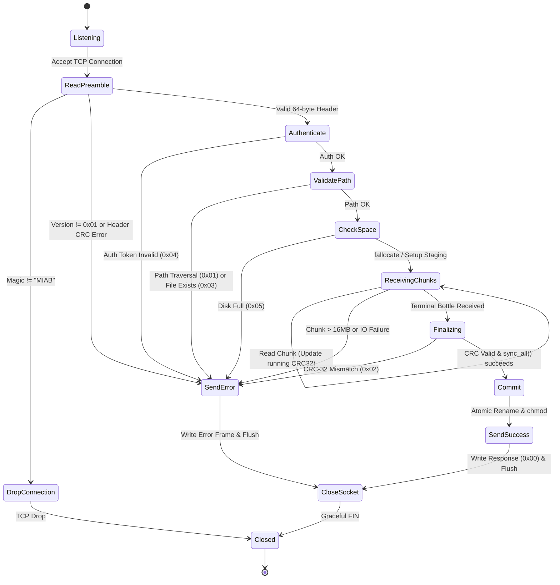

# RFC 001: Message In A Bottle Wire Protocol (MIAB v1)

```
Network Working Group                                          MIAB Project
Request for Comments: 001                                   Protocol Engine
Category: Standards Track                                      October 2026
```

---

## Abstract

This document defines the Message In A Bottle (MIAB) Transport Protocol version 1 (MIAB v1). MIAB is a lightweight, high-performance, bounded-memory binary blob transport engine designed specifically for edge nodes, IoT devices, microcontrollers (MCUs), and homelabs operating over private networks (e.g., Tailscale, WireGuard, LAN).

MIAB eliminates the protocol and memory overhead of HTTP/REST, multipart MIME, and gRPC. It operates over a single raw TCP connection using a word-aligned, CPU cache-line friendly (64-byte) fixed binary header, followed by chunked binary streams ("Bottles") and an end-of-transfer hardware-accelerated CRC-32 integrity validation.

---

## Status of This Document

This document is the official, definitive wire protocol specification for MIAB v1. Conforming implementations in any programming language (Rust, Python, C, Go, Zig, etc.) MUST adhere to the wire representations, state transitions, alignment rules, and security constraints described herein.

---

## Table of Contents

1. [Terminology & Conformance](#1-terminology--conformance)
2. [Protocol Architecture](#2-protocol-architecture)
3. [Data Types & Endianness](#3-data-types--endianness)
4. [Wire Framing Specification](#4-wire-framing-specification)
   - 4.1. [Fixed Header Preamble (64 Bytes)](#41-fixed-header-preamble-64-bytes)
   - 4.2. [Variable Header Extensions (Path & Metadata)](#42-variable-header-extensions-path--metadata)
   - 4.3. [Bottle Chunks (Client $\rightarrow$ Server)](#43-bottle-chunks-client--server)
   - 4.4. [Terminal Bottle & Integrity Verification](#44-terminal-bottle--integrity-verification)
   - 4.5. [Server Response (Server $\rightarrow$ Client)](#45-server-response-server--client)
5. [State Machine & Connection Lifecycle](#5-state-machine--connection-lifecycle)
6. [Microcontroller (MCU) Implementation Guide](#6-microcontroller-mcu-implementation-guide)
7. [Security Considerations & Path Sanitization](#7-security-considerations--path-sanitization)
8. [Error Handling & Failure Modes](#8-error-handling--failure-modes)
9. [Test Vectors & Binary Examples](#9-test-vectors--binary-examples)
10. [Network Configuration](#10-network-configuration)

---

## 1. Terminology & Conformance

The key words **"MUST"**, **"MUST NOT"**, **"REQUIRED"**, **"SHALL"**, **"SHALL NOT"**, **"SHOULD"**, **"SHOULD NOT"**, **"RECOMMENDED"**, **"MAY"**, and **"OPTIONAL"** in this document are to be interpreted as described in [RFC 2119](https://www.ietf.org/rfc/rfc2119.txt).

- **Client**: The initiating network endpoint sending or requesting a binary payload.
- **Server / Daemon (`miabd`)**: The receiving network daemon writing payloads safely into a configured storage root.
- **Fixed Header**: A strictly 64-byte binary preamble containing protocol metadata, offsets, and credentials.
- **Bottle**: A discrete length-prefixed chunk of binary payload data.
- **Terminal Bottle**: A zero-length chunk bottle signaling payload completion, optionally bearing an end-of-stream CRC-32 integrity checksum.

---

## 2. Protocol Architecture

MIAB executes over a stream-oriented transport layer (TCP). An entire transfer session runs within a single TCP connection:

```
Client                                                   Server
  |                                                         |
  |--- [1] 64-Byte Fixed Header + Path [+ Metadata] ------->|
  |                                                         |
  |--- [2] Bottle Chunk 1 (Length L1, Payload L1) --------->|
  |--- [3] Bottle Chunk 2 (Length L2, Payload L2) --------->|
  |--- [...] Bottle Chunk N ------------------------------->|
  |                                                         |
  |--- [4] Terminal Bottle (Length = 0, CRC-32) ----------->|
  |                                                         |
  |<-- [5] Server Response (Status, Message Length, Msg) ---|
  |                                                         |
 [TCP Close]                                           [TCP Close]
```

1. **Client Connects**: The client initiates a TCP connection to the server (default port `6422`).
2. **Handshake Header**: The client sends the 64-byte fixed header, immediately followed by the relative path string, and an optional metadata block.
3. **Validation & Pre-allocation**: The server verifies credentials, sanitizes the path, checks available disk space, and optionally prepares atomic staging.
4. **Chunk Streaming**: The client streams sequential chunk bottles (typically 64 KB, or smaller for microcontrollers).
5. **Terminal Verification**: The client sends the Terminal Bottle (`Length = 0`) with the computed CRC-32 checksum.
6. **Durability & Response**: The server validates the checksum, flushes to disk (`fsync`), executes an atomic rename, and transmits the response frame before closing.

---

## 3. Data Types & Endianness

All multi-byte numeric fields in the MIAB protocol **MUST** be transmitted in **network byte order (Big-Endian)**.

| Type | Size | Description |
| :--- | :--- | :--- |
| `u8` | 1 byte | Unsigned 8-bit integer (0 to 255) |
| `u16` | 2 bytes | Unsigned 16-bit integer, Big-Endian (0 to 65,535) |
| `u32` | 4 bytes | Unsigned 32-bit integer, Big-Endian (0 to 4,294,967,295) |
| `u64` | 8 bytes | Unsigned 64-bit integer, Big-Endian (0 to $1.84 \times 10^{19}$) |
| `bytes` | Variable | Raw binary octet slice |
| `string` | Variable | UTF-8 encoded text string, length-prefixed, without null termination |

### Natural Alignment Invariant
Every field within the 64-byte Fixed Header is aligned to a multiple of its own size (e.g. `u64` at 8-byte offsets, `u16` at 2-byte offsets). This guarantees zero-copy casting without alignment faults on 32-bit RISC or ARM Cortex-M0 microcontrollers.

---

## 4. Wire Framing Specification

### 4.1. Fixed Header Preamble (64 Bytes)

Sent immediately upon establishing the TCP connection:

```
 0                   1                   2                   3
 0 1 2 3 4 5 6 7 8 9 0 1 2 3 4 5 6 7 8 9 0 1 2 3 4 5 6 7 8 9 0 1
+-+-+-+-+-+-+-+-+-+-+-+-+-+-+-+-+-+-+-+-+-+-+-+-+-+-+-+-+-+-+-+-+
|                       Magic "MIAB" (4B)                       |
+-+-+-+-+-+-+-+-+-+-+-+-+-+-+-+-+-+-+-+-+-+-+-+-+-+-+-+-+-+-+-+-+
|  Version (1B) |  Opcode (1B)  |          Flags (2B)           |
+-+-+-+-+-+-+-+-+-+-+-+-+-+-+-+-+-+-+-+-+-+-+-+-+-+-+-+-+-+-+-+-+
|       Content Tag (2B)        |        Path Length N (2B)     |
+-+-+-+-+-+-+-+-+-+-+-+-+-+-+-+-+-+-+-+-+-+-+-+-+-+-+-+-+-+-+-+-+
|                                                               |
+                    Expected Total Size (8B, u64)              +
|                                                               |
+-+-+-+-+-+-+-+-+-+-+-+-+-+-+-+-+-+-+-+-+-+-+-+-+-+-+-+-+-+-+-+-+
|                                                               |
+                 Resume / Start Byte Offset (8B, u64)          +
|                                                               |
+-+-+-+-+-+-+-+-+-+-+-+-+-+-+-+-+-+-+-+-+-+-+-+-+-+-+-+-+-+-+-+-+
|                                                               |
+                 Unix Timestamp mtime (8B, u64 ms)             +
|                                                               |
+-+-+-+-+-+-+-+-+-+-+-+-+-+-+-+-+-+-+-+-+-+-+-+-+-+-+-+-+-+-+-+-+
|                                                               |
+             Auth Token / Device UUID / PSK (16B)              +
|                                                               |
+                                                               +
|                                                               |
+-+-+-+-+-+-+-+-+-+-+-+-+-+-+-+-+-+-+-+-+-+-+-+-+-+-+-+-+-+-+-+-+
|                    Trace ID / Correlation (8B)                |
|                                                               |
+-+-+-+-+-+-+-+-+-+-+-+-+-+-+-+-+-+-+-+-+-+-+-+-+-+-+-+-+-+-+-+-+
|      Metadata Len M (2B)      |       Header CRC-16 (2B)      |
+-+-+-+-+-+-+-+-+-+-+-+-+-+-+-+-+-+-+-+-+-+-+-+-+-+-+-+-+-+-+-+-+  <-- Exactly 64 Bytes
```

#### Field Definitions:

1. **Magic Bytes (4 bytes)**:
   - Fixed byte sequence: ASCII `"MIAB"` (`[0x4D, 0x49, 0x41, 0x42]`).
   - If magic does not match, server **MUST** drop connection immediately without response.
2. **Version (1 byte)**:
   - Value for this specification: `0x01`.
   - If unsupported, server responds with `Status = 0x01` and closes.
3. **Opcode (1 byte)**:
   - `0x01` = `PUT`: Upload payload to target path.
   - `0x02` = `GET`: Download payload from target path.
   - `0x03` = `STAT`: Query metadata and existence.
   - `0x04` = `DELETE`: Safely remove file.
4. **Flags (2 bytes, `u16` BE)**:
   - `0x0001` - `NO_OVERWRITE`: Abort if target file exists.
   - `0x0002` - `APPEND`: Append chunks to existing file.
   - `0x0004` - `ATOMIC_TMP`: Write to `.target.part` and atomic rename on verification.
   - `0x0008` - `SET_EXECUTABLE`: Apply `chmod +x` (0o755) permissions.
   - `0x0010` - `CHECKSUM_PRESENT`: Terminal bottle includes a 4-byte CRC-32.
   - `0x0020` - `HAS_METADATA`: Metadata payload follows Path.
5. **Content Tag (2 bytes, `u16` BE)**:
   - Binary format enum:
     - `0x0000`: `GENERIC_BINARY` (`.bin`)
     - `0x0001`: `JPEG_IMAGE` (`.jpg`)
     - `0x0002`: `VIDEO_STREAM` (`.mp4`, `.ts`)
     - `0x0003`: `CSV_TELEMETRY` (`.csv`)
     - `0x0004`: `TAR_ARCHIVE` (`.tar`)
     - `0x0005`: `SQLITE_DB` (`.sqlite`)
     - `0x0006`: `ZSTD_COMPRESSED` (`.zst`)
6. **Path Length (2 bytes, `u16` BE)**:
   - Byte count $N$ of the relative path string ($1 \le N \le 65535$).
7. **Expected Total Size (8 bytes, `u64` BE)**:
   - Expected payload size in bytes. Enables `fallocate()` disk pre-allocation and space check. Set to `0xFFFFFFFFFFFFFFFF` for indefinite/live pipe streams.
8. **Byte Offset (8 bytes, `u64` BE)**:
   - Starting write offset for resuming interrupted transfers. `0x0000000000000000` for standard transfers.
9. **Timestamp `mtime` (8 bytes, `u64` BE)**:
   - Unix epoch timestamp in milliseconds. `0` indicates server should use current time.
10. **Auth Token (16 bytes)**:
    - 128-bit pre-shared device token, UUID, or API key. All zeros (`0x00...00`) if auth is disabled.
11. **Trace ID (8 bytes, `u64` BE)**:
    - OpenTelemetry / distributed correlation ID. All zeros if unused.
12. **Metadata Length (2 bytes, `u16` BE)**:
    - Byte count $M$ of optional trailing metadata block ($0 \le M \le 65535$).
13. **Header CRC-16 (2 bytes, `u16` BE)**:
    - CRC-16/CCITT checksum over the preceding 62 bytes of the header. Set to `0x0000` if header validation is disabled.

---

### 4.2. Variable Header Extensions (Path & Metadata)

Immediately following the 64-byte Fixed Header:

```
+-+-+-+-+-+-+-+-+-+-+-+-+-+-+-+-+-+-+-+-+-+-+-+-+-+-+-+-+-+-+-+-+
|                    Relative Path String (N Bytes)             |
|                                 ...                           |
+-+-+-+-+-+-+-+-+-+-+-+-+-+-+-+-+-+-+-+-+-+-+-+-+-+-+-+-+-+-+-+-+
|              Optional Metadata Block (M Bytes, e.g. JSON)     |
|                                 ...                           |
+-+-+-+-+-+-+-+-+-+-+-+-+-+-+-+-+-+-+-+-+-+-+-+-+-+-+-+-+-+-+-+-+
```

1. **Relative Path ($N$ bytes)**: UTF-8 string (e.g. `"sensors/cam01/photo.jpg"`).
2. **Metadata Block ($M$ bytes)**: Arbitrary application metadata (e.g. JSON string). Only read if `HAS_METADATA` flag (`0x0020`) is set and $M > 0$.

---

### 4.3. Bottle Chunks (Client $\rightarrow$ Server)

Payload data streams in sequential chunk bottles:

```
 0                   1                   2                   3
 0 1 2 3 4 5 6 7 8 9 0 1 2 3 4 5 6 7 8 9 0 1 2 3 4 5 6 7 8 9 0 1
+-+-+-+-+-+-+-+-+-+-+-+-+-+-+-+-+-+-+-+-+-+-+-+-+-+-+-+-+-+-+-+-+
|                      Chunk Length L (4B)                      |
+-+-+-+-+-+-+-+-+-+-+-+-+-+-+-+-+-+-+-+-+-+-+-+-+-+-+-+-+-+-+-+-+
|                     Chunk Payload (L Bytes)                   |
|                              ...                              |
+-+-+-+-+-+-+-+-+-+-+-+-+-+-+-+-+-+-+-+-+-+-+-+-+-+-+-+-+-+-+-+-+
```

- **Chunk Length (4 bytes, `u32` BE)**: $1 \le L \le 16777216$ (16 MB maximum).
- Standard chunk size is **65,536 bytes (64 KB)** on desktops/servers, or **1,024 to 4,096 bytes** on microcontrollers.

---

### 4.4. Terminal Bottle & Integrity Verification

To finalize the payload stream:

```
 0                   1                   2                   3
 0 1 2 3 4 5 6 7 8 9 0 1 2 3 4 5 6 7 8 9 0 1 2 3 4 5 6 7 8 9 0 1
+-+-+-+-+-+-+-+-+-+-+-+-+-+-+-+-+-+-+-+-+-+-+-+-+-+-+-+-+-+-+-+-+
|                 Chunk Length = 0x00000000 (4B)                |
+-+-+-+-+-+-+-+-+-+-+-+-+-+-+-+-+-+-+-+-+-+-+-+-+-+-+-+-+-+-+-+-+
|                [OPTIONAL] CRC-32 Checksum (4B)                |
+-+-+-+-+-+-+-+-+-+-+-+-+-+-+-+-+-+-+-+-+-+-+-+-+-+-+-+-+-+-+-+-+
```

- Length is strictly 4 bytes of zeros: `[0x00, 0x00, 0x00, 0x00]`.
- If `CHECKSUM_PRESENT` (`0x0010`) is set, exactly **4 bytes of CRC-32** (IEEE 802.3 / CRC-32-Castagnoli) follow immediately.
- The server checks the received CRC against its running calculation. If it differs, the server deletes the file and returns `Status 0x02`.

---

### 4.5. Server Response (Server $\rightarrow$ Client)

```
 0                   1                   2                   3
 0 1 2 3 4 5 6 7 8 9 0 1 2 3 4 5 6 7 8 9 0 1 2 3 4 5 6 7 8 9 0 1
+-+-+-+-+-+-+-+-+-+-+-+-+-+-+-+-+-+-+-+-+-+-+-+-+-+-+-+-+-+-+-+-+
|  Status (1B)  |       Message Length M (2B)   |               |
+-+-+-+-+-+-+-+-+-+-+-+-+-+-+-+-+-+-+-+-+-+-+-+-+               |
|                    Message String (M Bytes)                   |
|                              ...                              |
+-+-+-+-+-+-+-+-+-+-+-+-+-+-+-+-+-+-+-+-+-+-+-+-+-+-+-+-+-+-+-+-+
```

#### Status Codes:
- `0x00` = **OK**: Transfer completed, verified, and synced to disk.
- `0x01` = **FAIL**: General IO / server error.
- `0x02` = **CHECKSUM_MISMATCH**: End-of-transfer CRC-32 mismatch.
- `0x03` = **FILE_EXISTS**: Target file exists and `NO_OVERWRITE` was set.
- `0x04` = **AUTH_FAILED**: Invalid or missing device token.
- `0x05` = **INSUFFICIENT_SPACE**: Expected size exceeds available filesystem capacity.
- `0x06` = **HEADER_CORRUPTED**: Header CRC-16 mismatch or malformed preamble.

---

## 5. State Machine & Connection Lifecycle



---

## 6. Microcontroller (MCU) Implementation Guide

Because all fields in the 64-byte Fixed Header are naturally aligned to word boundaries, microcontrollers can represent the header as a static C structure:

```c
#include <stdint.h>

typedef struct __attribute__((packed)) {
    uint32_t magic;          // 0x4D494142 ("MIAB")
    uint8_t  version;        // 0x01
    uint8_t  opcode;         // 0x01 (PUT)
    uint16_t flags;          // 0x0014 (ATOMIC_TMP | CHECKSUM_PRESENT)
    uint16_t content_tag;    // 0x0001 (JPEG_IMAGE)
    uint16_t path_len;       // Big-endian uint16
    uint64_t expected_size;  // Big-endian uint64 (or 0xFFFFFFFFFFFFFFFF)
    uint64_t byte_offset;    // 0x0000000000000000
    uint64_t timestamp_ms;   // Epoch ms from RTC / NTP
    uint8_t  auth_token[16]; // Pre-shared 16-byte key
    uint64_t trace_id;       // 0x0000000000000000
    uint16_t metadata_len;   // 0x0000
    uint16_t header_crc16;   // CRC-16 of first 62 bytes (or 0)
} miab_v1_header_t;
```

### Complete Microcontroller Client Flow (C / lwIP / FreeRTOS)
```c
// 1. Establish TCP socket to server
int sock = socket(AF_INET, SOCK_STREAM, 0);
connect(sock, (struct sockaddr*)&server_addr, sizeof(server_addr));

// 2. Transmit 64-byte Fixed Header + Path in 2 calls
send(sock, &header, sizeof(miab_v1_header_t), 0);
send(sock, "cam/porch.jpg", 13, 0);

// 3. Stream payload chunks directly from camera buffer (e.g. 1 KB slices)
while (bytes_remaining > 0) {
    uint32_t slice_len = (bytes_remaining > 1024) ? 1024 : bytes_remaining;
    uint32_t be_len = htonl(slice_len);
    send(sock, &be_len, 4, 0);
    send(sock, buffer_ptr, slice_len, 0);
    buffer_ptr += slice_len;
    bytes_remaining -= slice_len;
}

// 4. Send Terminal Bottle + CRC-32
uint32_t term_bottle[2] = { 0x00000000, htonl(computed_crc32) };
send(sock, term_bottle, sizeof(term_bottle), 0);

// 5. Read 3-byte response header
uint8_t resp_hdr[3];
recv(sock, resp_hdr, 3, MSG_WAITALL);
// resp_hdr[0] == 0x00 -> SUCCESS!
close(sock);
```

---

## 7. Security Considerations & Path Sanitization

Servers **MUST** enforce strict destination path validation before opening any file descriptor.

1. **Empty Path**: Path string length $N$ MUST NOT be `0`.
2. **Leading Slashes**: Path MUST NOT begin with `/` (POSIX root) or `\` (Windows root).
3. **Directory Traversal**: Path MUST NOT contain any directory component equal to `".."` or substring `".."`.
4. **Drive Prefixes**: Path MUST NOT contain colons (`:`) or Windows drive letters (e.g. `"C:"`).
5. **Component Normalization**: All path components MUST resolve strictly within the configured storage root.
6. **Parent Directory Creation**: Servers MUST create parent directories automatically (`mkdir -p`) safely bounded by the storage root.

---

## 8. Error Handling & Failure Modes

| Condition | Cause | Server Action |
| :--- | :--- | :--- |
| **Magic Mismatch** | First 4 bytes $\ne$ `MIAB` | Immediately drop TCP socket without transmitting response. |
| **Unsupported Version** | Version byte $\ne$ `0x01` | Transmit Response `Status = 0x01`, close socket. |
| **Header CRC Error** | Preamble corrupted | Transmit Response `Status = 0x06`, close socket. |
| **Auth Failure** | Token mismatch | Transmit Response `Status = 0x04`, close socket. |
| **Path Traversal** | Path contains `..` | Transmit Response `Status = 0x01`, close socket. |
| **File Exists** | `NO_OVERWRITE` set | Transmit Response `Status = 0x03`, close socket. |
| **Disk Full** | Expected size > free disk | Transmit Response `Status = 0x05`, close socket. |
| **CRC-32 Mismatch** | Payload bit-flip detected | Delete staging file, transmit `Status = 0x02`, close socket. |
| **Chunk > 16 MB** | Limit exceeded | Transmit Response `Status = 0x01`, close socket. |

---

## 9. Test Vectors & Binary Examples

### 9.1. Valid 64-Byte PUT Header
- Target Path: `"test.bin"` (8 bytes: `0x74 0x65 0x73 0x74 0x2E 0x62 0x69 0x6E`)
- Flags: `ATOMIC_TMP` | `CHECKSUM_PRESENT` (`0x0014`)
- Content Tag: `GENERIC_BINARY` (`0x0000`)
- Expected Size: 5 bytes (`0x0000000000000005`)
- Offset: 0, Timestamp: 0, Token: zeros, Trace ID: 0, Metadata: 0, Header CRC: 0

```
Hex Stream (First 64 Bytes):
4D 49 41 42  01 01 00 14  00 00 00 08  00 00 00 00  // MIAB | Ver 1 | Op 1 | Flags | Tag 0 | PathLen 8 | Size hi
00 00 00 05  00 00 00 00  00 00 00 00  00 00 00 00  // Size lo (5) | Offset 0 | mtime hi
00 00 00 00  00 00 00 00  00 00 00 00  00 00 00 00  // mtime lo | Token (first 12 bytes)
00 00 00 00  00 00 00 00  00 00 00 00  00 00 00 00  // Token (last 4B) | Trace ID (8B) | MetaLen 0 | CRC16 0

Followed by Path (8 Bytes):
74 65 73 74 2E 62 69 6E (test.bin)
```

### 9.2. A 5-Byte Chunk
Chunk containing `"HELLO"`:
```
00 00 00 05  48 45 4C 4C 4F
| Len = 5 |  H  E  L  L  O |
```

### 9.3. Terminal Bottle with CRC-32
Terminal bottle for `"HELLO"` (CRC-32 = `0x3610A686`):
```
00 00 00 00  36 10 A6 86
| Len = 0 |  CRC-32     |
```

### 9.4. Server Success Response
`Status = 0x00 (OK)`, Message = `"Saved 5 bytes"` (13 bytes):
```
00 00 0D 53 61 76 65 64 20 35 20 62 79 74 65 73
|OK|Len=13| S  a  v  e  d     5     b  y  t  e  s |
```

---

## 10. Network Configuration

- **Default Port**: `6422` / TCP.
- **Transport Security**: MIAB operates over raw TCP and does not implement in-band TLS. It is intended to run over authenticated private overlays such as **Tailscale**, **WireGuard**, IPsec, or trusted local homelab / IoT VLANs. For environments without VPN overlays, the 16-byte `Auth Token` field provides device-level capability authentication.
